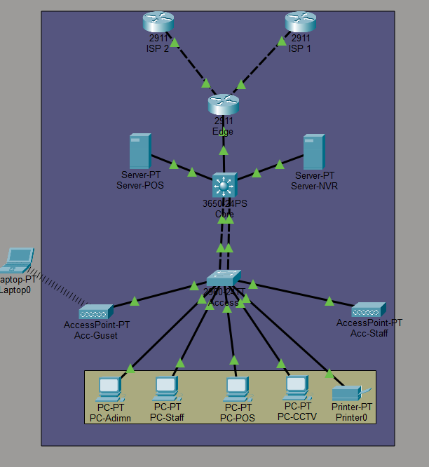

# Cafe Network Design

A secure, redundant and scalable network for a mid-sized café (30–100 devices), designed and validated in Cisco Packet Tracer.

**Services:** guest and staff Wi-Fi, POS, CCTV, internal server (POS, NVR, Syslog).

## Topology


```
ISP1 (primary) ─┐
                ├─ Edge-R1 (NAT + dual WAN) ─ Core-SW (VLANs + ACLs + DHCP) ─┬─ Access-SW1 (LACP + port security)
ISP2 (backup) ──┘                                                           └─ Servers
```

## Key Features
- **Dual-WAN failover**: automatic switchover to ISP2 and return to ISP1 on recovery
- **8 isolated VLANs** with ACL-enforced policies
- **Secure management**: SSH only, Telnet disabled, encrypted passwords, login banner
- **Layer 2 security**: DHCP snooping, port security, unused ports shut down, STP root on core
- **Edge protection**: anti-spoofing ACLs, CDP disabled toward ISPs
- **Monitoring**: central Syslog

## VLAN Plan
| VLAN | Name | Subnet | Access |
|------|------|--------|--------|
| 10 | Management | 192.168.10.0/24 | Network devices, SSH only |
| 20 | Staff | 192.168.20.0/24 | Internet, servers, printers |
| 30 | POS | 192.168.30.0/24 | POS server and payment gateway only |
| 40 | Servers | 192.168.40.0/24 | POS server and NVR |
| 50 | Kitchen & Printers | 192.168.50.0/24 | Servers only |
| 60 | CCTV | 192.168.60.0/24 | NVR only, no internet |
| 70 | Guest Wi-Fi | 192.168.70.0/24 | Internet only |
| 80 | IoT | 192.168.80.0/24 | Internet only |

## Test Results
| Test | Expected | Result |
|------|----------|--------|
| Guest → Internet | Allowed | Passed |
| Guest → POS server | Blocked | Passed |
| POS → POS server | Allowed | Passed |
| POS → Staff | Blocked | Passed |
| Camera → NVR | Allowed | Passed |
| Camera → Internet | Blocked | Passed |
| Staff → Printer | Allowed | Passed |
| Primary link cut | Internet continues | Passed |
| SSH from Management | Allowed | Passed |
| SSH from Staff | Blocked | Passed |

## Limitations (Packet Tracer)
ACLs are stateless (no full firewall), second-link NAT is simplified, and Wi-Fi uses two standalone APs instead of a WLC.

## Future Improvements
FortiGate firewall (stateful + IPS), HA, WLC + RADIUS, IPsec/SD-WAN for branches.

## Files
- `Caffe.pkt`: Packet Tracer project
- `topology.png`: network diagram
- `Handover.pdf`: full documentation
